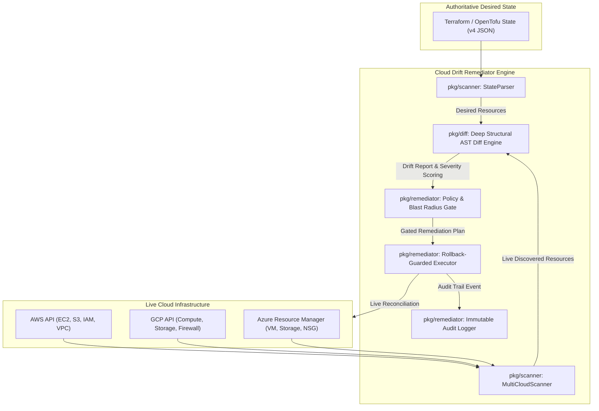

<div align="center">

```
   _____ _                 _   _____       _  __ _   
  / ____| |               | | |  __ \     (_)/ _| |  
 | |    | | ___  _   _  __| | | |  | |_ __ _| |_| |_ 
 | |    | |/ _ \| | | |/ _` | | |  | | '__| |  _| __|
 | |____| | (_) | |_| | (_| | | |__| | |  | | | | |_ 
  \_____|_|\___/ \__,_|\__,_| |_____/|_|  |_|_|  \__|
```

### Multi-Cloud Infrastructure Drift Detector with Auto-Remediation in Go

[](https://github.com/ER-brocode/cloud-drift-remediator/actions/workflows/ci.yml)
[](https://golang.org)
[](LICENSE)
[](https://docs.github.com/en/code-security)
[](#)
[](#)

*Continuous declarative reconciliation engine detecting out-of-band mutations, unmanaged shadow IT, and security regressions across multi-cloud topologies with automated policy-guided rollback guards.*

---

</div>

## 📑 Table of Contents

- [Overview](#-overview)
- [Architecture & Execution Pipeline](#-architecture--execution-pipeline)
- [Key Features](#-key-features)
- [Installation](#-installation)
- [Quick Start](#-quick-start)
- [CLI Reference](#-cli-reference)
- [Declarative Governance Policy](#-declarative-governance-policy)
- [Security & Compliance](#-security--compliance)
- [Continuous Daemon Mode](#-continuous-daemon-mode)
- [Automated Test Suite](#-automated-test-suite)
- [License](#-license)

---

## ⚡ Overview

**Cloud Drift Remediator** bridges the critical gap between desired state declarative infrastructure (Terraform, OpenTofu) and actual live cloud runtime states. While traditional IaC plans identify differences during deployment windows, **Cloud Drift Remediator** operates continuously to:

1. **Detect Out-of-Band Divergence**: Identify illicit or accidental console changes in real time.
2. **Flag Rogue Shadow IT**: Discover unmanaged cloud resources spun up outside IaC definitions.
3. **Classify Risk Contextually**: Escalate security violations (e.g. `0.0.0.0/0` security group openings, public S3 buckets) to `CRITICAL` severity while categorizing tag updates as `LOW`.
4. **Enforce Safe Automated Remediation**: Reconcile drifted attributes back to authoritative IaC state within configurable blast-radius limits and automatic rollback fail-safes.

```
+-------------------------------------------------------------------------------+
|                        TERMINAL DRIFT DETECTION STREAM                        |
+-------------------------------------------------------------------------------+
| [09:24:12] INFO  Scanner parsed Terraform v4 state (2 resources tracked)      |
| [09:24:13] INFO  Querying AWS API [us-east-1] and live resource inventory... |
| [09:24:14] WARN  DRIFT DETECTED: sg-0abcd1234ef567890 (aws_security_group)   |
|            -> Path: ingress[0].cidr_blocks                                    |
|            -> Desired: ["10.0.0.0/16"]                                        |
|            -> Actual:  ["0.0.0.0/0"]                                          |
|            -> Severity: CRITICAL [Broadened to public world access]          |
| [09:24:15] EXEC  Reconciling live security group to IaC baseline...           |
| [09:24:16] SUCC  State restored. Cryptographic audit event logged.            |
+-------------------------------------------------------------------------------+
```

---

## 🏗 Architecture & Execution Pipeline

The remediator is built around a decoupled, highly concurrent modular architecture:



---

## 🌟 Key Features

- **Multi-Cloud State Ingestion**: Native parser for Terraform / OpenTofu state specification v4 across AWS, GCP, and Azure.
- **Deep Structural AST Diffing**: Recursive property tree traversal with fuzzy type coercion (numeric strings, boolean conversions, null vs empty structures).
- **Sensitive Field Shielding**: Automatic masking of database credentials, access keys, and IAM secret material (`********`) in diff reports, terminal streams, and audit logs.
- **Dynamic Field Suppression**: Built-in suppression for ephemeral and provider-generated metadata (ETags, ARNs, timestamps, version IDs).
- **Configurable Blast Radius Safety Gates**: Quantitative risk scoring prevents runaway mutations. If proposed changes exceed safety thresholds, human approval is strictly required.
- **Automated Rollback Engine**: Generates inverse rollback definitions before executing any mutation; if a reconciliation operation fails, the previous state is immediately restored.
- **Enterprise Reporting**: Outputs formatted terminal tables, structured JSON, and OASIS SARIF v2.1.0 for native integration with GitHub Code Scanning.

---

## 🚀 Installation

### Via Source (Go 1.22+)

```bash
# Clone the repository
git clone https://github.com/ER-brocode/cloud-drift-remediator.git
cd cloud-drift-remediator

# Compile the production binary
go build -ldflags="-s -w" -o bin/remediator ./cmd/remediator

# Verify installation
./bin/remediator version
```

### Precompiled Cross-Platform Binaries

Release binaries are published automatically via GitHub Actions for:
- Linux (`amd64`, `arm64`)
- macOS (`amd64`, `arm64` Apple Silicon)
- Windows (`amd64`)

---

## 💻 Quick Start

### 1. Perform a Drift Scan

Scan a live environment against a local or remote Terraform state file:

```bash
remediator scan --state terraform.tfstate --output text
```

Output:
```
================================================================================
                        CLOUD DRIFT DETECTION REPORT                            
================================================================================
Report ID:    drift-1792295767297840900
Generated At: 2026-10-18T09:26:07Z
Duration:     14 ms
Desired:      2 | Live: 2 | Drifted: 1
Severities:   Critical: 1 | High: 0 | Medium: 0 | Low: 0 | Info: 0
--------------------------------------------------------------------------------
[CRITICAL] sg-0abcd1234ef567890 (aws_security_group) Provider: aws
  Type: MODIFIED
  - Path: ingress[0].cidr_blocks
    Desired: [10.0.0.0/16]
    Actual:  [0.0.0.0/0]
    Reason:  Inbound security rule was broadened to allow public ingress (0.0.0.0/0)
================================================================================
```

### 2. Export SARIF for GitHub Security Tab

```bash
remediator scan --state terraform.tfstate --output sarif > drift-results.sarif
```

### 3. Dry-Run Auto-Remediation

Simulate remediation actions without executing live changes:

```bash
remediator remediate --state terraform.tfstate --policy policy.json --dry-run
```

---

## 📖 CLI Reference

```
Usage: cloud-drift-remediator <command> [options]

Commands:
  scan       Scan live cloud infrastructure and compare against IaC state
  diff       Perform deep AST structural diff between desired and live states
  remediate  Execute safe policy-guided auto-reconciliation and rollbacks
  serve      Run continuous monitoring daemon with HTTP health and metrics API
  version    Display version information
```

### Options for `scan`
| Flag | Default | Description |
|---|---|---|
| `--state` | *required* | Path to Terraform or OpenTofu state file |
| `--output` | `text` | Formatter: `text`, `json`, or `sarif` |
| `--exit-code` | `true` | Return exit code `2` on detected drift (ideal for CI pipelines) |

### Options for `remediate`
| Flag | Default | Description |
|---|---|---|
| `--state` | *required* | Path to Terraform or OpenTofu state file |
| `--policy` | `""` | Path to declarative policy JSON (uses default if omitted) |
| `--dry-run` | `false` | Simulate execution without applying cloud mutations |
| `--auto-approve` | `false` | Bypass manual approval gates if within blast radius |
| `--audit-log` | `audit.log` | Path for structured append-only audit trail |

---

## 🛡 Declarative Governance Policy

Governance policies are written in JSON and allow platform teams to define granular auto-remediation rules and blast radius limits:

```json
{
  "version": "1.0",
  "auto_remediate": true,
  "max_blast_radius": 15,
  "require_approval": false,
  "allowed_severities": ["CRITICAL", "HIGH", "MEDIUM", "LOW", "INFO"],
  "protected_resources": [
    ".*production-database.*",
    ".*prod-vpc.*",
    ".*core-iam-root.*"
  ],
  "action_overrides": {
    "aws_s3_bucket": "UPDATE"
  },
  "rules": [
    {
      "name": "Auto-restore Security Groups on Ingress Drift",
      "resource_type": "aws_security_group",
      "drift_type": "MODIFIED",
      "action": "UPDATE",
      "requires_gate": false
    }
  ]
}
```

---

## 🔒 Security & Compliance

- **Zero Storage of Cleartext Credentials**: Evaluates differences in memory; sensitive fields matching `password`, `token`, `secret`, or `private_key` are masked before serialization.
- **Blast Radius Protection**: Each operation is scored by risk weight. If accumulated score exceeds policy thresholds, automated action halts immediately.
- **Protected Resources**: Regular expressions protect databases, core routing tables, and VPCs from accidental destruction.
- **Append-Only Audit Trail**: Every reconciliation step logs an immutable JSON event record with nanosecond timestamp, target resource ID, and execution status.

---

## 🌐 Continuous Daemon Mode

Run Cloud Drift Remediator as a daemon or Kubernetes sidecar:

```bash
remediator serve --port 8080
```

Endpoints exposed:
- `GET /healthz`: Liveness and readiness probe
- `GET /metrics`: Prometheus metric metrics (`drift_evaluations_total`, `drift_detected_resources`)

---

## 🧪 Automated Test Suite

Cloud Drift Remediator is covered by automated unit and integration tests:

```bash
# Run all unit and integration tests
go test -v ./...

# Run tests with race detection and coverage profile
go test -v -race -coverprofile=coverage.out ./...
```

Test coverage includes:
- AST recursive type coercion and sensitive field masking
- Terraform v4 state parser and schema extraction
- Modified, missing, and unmanaged rogue resource detection
- Policy blast radius enforcement and protected resource isolation
- Multi-worker concurrent execution and automated rollback

---

## 📄 License

This project is licensed under the MIT License - see the [LICENSE](LICENSE) file for details.
